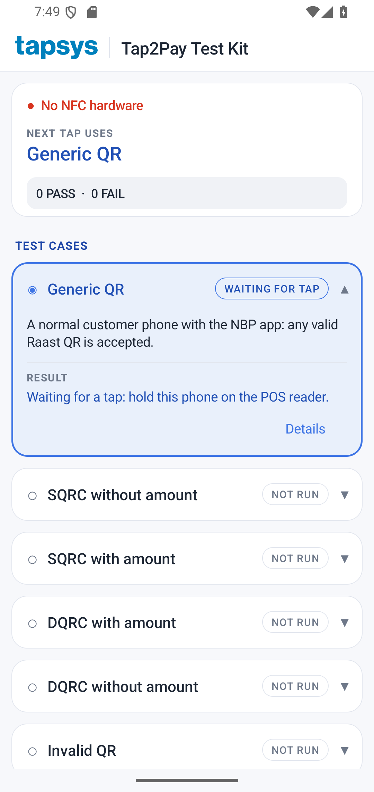
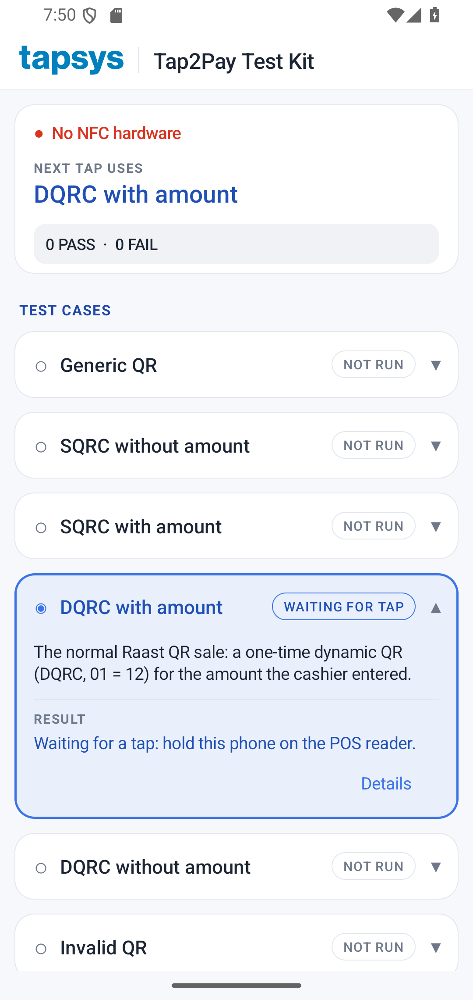

# Tapsys Tap2Pay Test Kit

Android phone test app for the customer side of Tap2Pay via Raast. Select a test case, tap a compatible POS, and inspect the NFC exchange, QR payload, and result on the phone. The app does not make or authorize a payment.

The app is [`phone-test`](phone-test/README.md) (version 0.5), built on the shared protocol code in `core`. See the [user guide](docs/USER_GUIDE.md) or [Word guide](docs/Tapsys_Tap2Pay_Test_Kit_User_Guide.docx) for setup and screen-by-screen instructions.

## Requirements

- Android 7.0 (API 24) or newer phone with NFC and Host Card Emulation (HCE). The phone app requires HCE hardware.
- A Tap2Pay-capable Urovo i9100 or Sunmi P3 POS that pushes a Raast QR over NFC.
- To build: JDK 17, Android SDK platform 33, and Android build tools. The Gradle wrapper is included.

## Build and install the phone app

1. Clone this repository and set `ANDROID_HOME` to your Android SDK, or add `local.properties` containing `sdk.dir=/path/to/Android/sdk`.
2. The checked-in `gradle.properties` pins a macOS Homebrew JDK path. If your JDK 17 is elsewhere, change or remove `org.gradle.java.home`, or override it on the Gradle command line.
3. From the repository root, run:

   ```bash
   ./gradlew :core:test :phone-test:assembleDebug
   ```

   On Windows use Git Bash for `gradlew` (this repository has no `gradlew.bat`). For example, with your actual JDK path:

   ```bash
   ./gradlew "-Dorg.gradle.java.home=C:/Program Files/Microsoft/jdk-17" :core:test :phone-test:assembleDebug
   ```

4. Install `phone-test/build/outputs/apk/debug/phone-test-debug.apk` on the phone, or run:

   ```bash
   adb install -r phone-test/build/outputs/apk/debug/phone-test-debug.apk
   ```

## Run a test

1. Enable NFC. Open **Tapsys Tap2Pay Test Kit** and check the status card. It should say **NFC ready**. If the NBP app is also installed, keep this screen open while tapping so this app receives the Tap2Pay AID.
2. Tap one of the six **Test cases** to select it. Its badge changes to **WAITING FOR TAP** until a tap arrives.
3. Start a Tap2Pay transaction on the POS and hold the phone against the reader until the exchange ends.
4. Open the selected case to see **PASS**, **FAIL**, or **CHECK POS** and the explanation. Tap **Details** for the expected behavior and APDU log. Use **Copy log** or **Copy all taps** when reporting a result.

| Case | Phone-side check |
| --- | --- |
| Generic QR | A valid Raast QR is received and accepted. |
| SQRC without amount | Static QR without amount tag `54`. |
| SQRC with amount | Static QR with a positive amount. |
| DQRC with amount | Dynamic QR with a positive amount. |
| DQRC without amount | Dynamic QR without amount tag `54`. |
| Invalid QR | The phone refuses a malformed QR; check that the POS reports the failure. |

**CHECK POS** means the phone behaved as expected for the Invalid QR case, and the POS outcome must be checked separately. See the [user guide](docs/USER_GUIDE.md#understand-the-results) for all badge meanings and troubleshooting.

## Screenshots

 

These are screens captured from the app on an Android emulator. The emulator cannot perform a physical NFC tap, so the status shows no NFC hardware. Use an NFC phone for actual testing. More images appear in the [user guide](docs/USER_GUIDE.md#screens-at-a-glance).

## Repository modules

| Module | Purpose |
| --- | --- |
| `phone-test` | Current customer-phone test app with six cases and tap logs. |
| `core` | Plain Java APDU, QR, validation, and test logic. |

## License

The source code is licensed under the [GNU Affero General Public License version 3](LICENSE). See [third-party notices](docs/THIRD_PARTY_NOTICES.md) for the Gradle wrapper. The Tapsys name, wordmark, and icon identify the test app.
