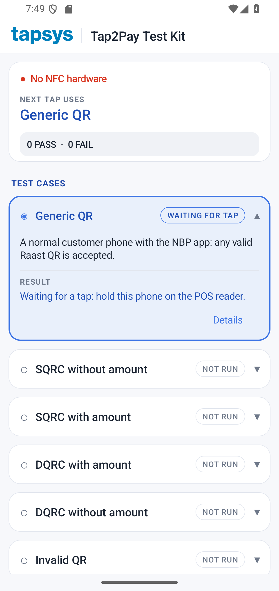
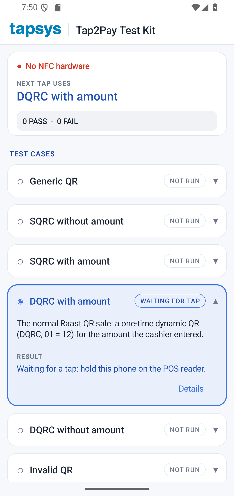
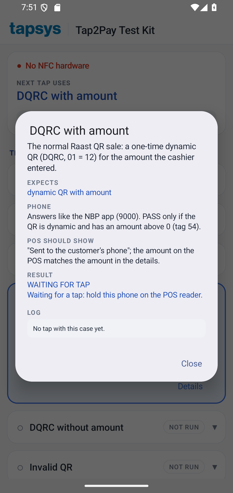

# Tapsys Tap2Pay Test Kit User Guide

Use this guide to install the phone test app, choose a Tap2Pay case, tap a POS, and interpret the NFC and QR result. The app receives and checks a Raast QR sent to the phone over NFC. It does not make or authorize a payment.

## Before you start

- Use an Android 7.0 (API 24) or newer phone with NFC and Host Card Emulation (HCE). The app requires HCE hardware. An emulator can display the interface but cannot perform a physical NFC tap.
- Use a compatible Urovo i9100 or Sunmi P3 POS running a Tap2Pay flow.
- Enable NFC on the phone. For the first test, keep the phone unlocked and the test kit open.
- If the NBP bank app is installed, keep the test kit in front while tapping. It registers the same Tap2Pay AID; the status card warns about this case.

## Build and install

The repository does not include a prebuilt APK.

1. Install JDK 17 and Android SDK platform 33. Set `ANDROID_HOME` to the SDK directory, or create `local.properties` with `sdk.dir=/path/to/Android/sdk`.
2. The checked-in `gradle.properties` points to a Homebrew JDK on macOS. Change or remove `org.gradle.java.home` if your JDK is elsewhere, or override it on the Gradle command line.
3. From the repository root run `./gradlew :core:test :phone-test:assembleDebug`. On Windows, use Git Bash; this repository has no `gradlew.bat`. One Windows override is `./gradlew "-Dorg.gradle.java.home=C:/Program Files/Microsoft/jdk-17" :core:test :phone-test:assembleDebug`, using your actual JDK path.
4. Install `phone-test/build/outputs/apk/debug/phone-test-debug.apk` on the phone. With USB debugging, run `adb install -r phone-test/build/outputs/apk/debug/phone-test-debug.apk`.

## Run a phone-side test

1. Open **Tapsys Tap2Pay Test Kit** and check the status card. It should say **NFC ready**. If it says NFC is off or taps are not routed to this app, resolve that first.
2. Under **Test cases**, tap the case you want. The row opens, becomes the selected case for the next tap, and shows **WAITING FOR TAP** until it receives one.
3. Start the Tap2Pay transaction on the POS. Hold the phone's NFC area on the reader until the exchange ends. A completed tap updates the selected case.
4. Read the badge and explanation. Open **Details** to see what the phone simulated, what the POS should show, the QR kind expected, and the APDU log. The newest tap appears first.
5. Use **Copy log** in Details or **Copy all taps** at the bottom of the case list to include the trace in a test record. The log can contain the QR and account fields, so review it before sharing.

The same QR can be used more than once. The case chosen when the POS sends SELECT stays assigned to that tap, even if you select another case during the transfer.

## Choose a test case

| Case | Expected QR and phone behavior | What to check on the POS |
| --- | --- | --- |
| **Generic QR** | Accepts a complete valid Raast QR. | POS shows that the QR was sent to the customer's phone. |
| **SQRC without amount** | Static QR (`01=11`) with no amount tag `54`. | POS reports a successful send. |
| **SQRC with amount** | Static QR with a positive amount in tag `54`. | Amount on POS matches the phone. |
| **DQRC with amount** | Dynamic QR (`01=12`) with a positive amount. | Amount on POS matches the phone. |
| **DQRC without amount** | Dynamic QR with no amount tag `54`. | POS reports a successful send. |
| **Invalid QR** | Refuses a complete invalid QR with status `6A80`. | POS reports failure, retry, or fallback rather than success. |

The Urovo FBL app normally produces DQRC with amount and SQRC without amount. The other two QR-kind cases need a POS or test tool that sends those kinds. The test kit accepts a valid QR even when its kind does not match the selected case; the phone then marks the case **FAIL** and explains the mismatch.

## Understand the results

| Badge | Meaning |
| --- | --- |
| **NOT RUN** | This case has no tap result yet. |
| **WAITING FOR TAP** | This case is selected for the next tap. |
| **IN PROGRESS** | The NFC exchange has started but has not finished. |
| **PASS** | The latest tap met this case's phone-side expectation. |
| **FAIL** | The phone saw a transfer, QR, or case mismatch problem. Open Details and read the explanation. |
| **CHECK POS** | In the Invalid QR case, the phone refused the QR as expected. Confirm the POS displayed a failure, retry, or fallback. |

The status card shows which case the next tap will use and the PASS and FAIL counts. **Clear results** resets the visible case outcomes. Finished taps are also written to the app's `taps.txt` log file; the interface's **Copy all taps** action is the easiest way to export them.

## Screens at a glance

These are actual app screens captured on an Android emulator. The emulator has no NFC hardware, so its red status line is expected. The screenshots show interface states only; a physical NFC phone is needed to test real APDUs.

### Test cases

The first screen lists all six cases and their current badges. Tap one case before testing.

### Selected case

The open row explains what it simulates and shows the current outcome. Only one row is open at a time.

### Details

Details explains the expected phone response and POS behavior, then lists tap logs once a tap is captured.

## Troubleshooting

| Symptom | What to check |
| --- | --- |
| **Cannot install or no NFC hardware** | Use a physical Android phone with NFC and HCE. The emulator is suitable only for viewing the interface. |
| **NFC is off** | Turn NFC on in Android Settings and reopen the test kit. |
| **Taps not routed here** | Keep this app in front. If another app registers the same AID, disable it for this test. |
| **WAITING FOR TAP does not change** | Confirm the POS started its Tap2Pay flow and keep the phone on the reader until it finishes. Check NFC routing on the status card. |
| **FAIL** | Open Details and compare the QR kind, amount, APDU sequence, and status words with the POS trace. |
| **CHECK POS** | The phone refused the QR as the case intended. Confirm the POS does not report success. |
| **Build fails before compilation** | Check JDK 17, Android SDK platform 33, and the Gradle JDK path. On Windows use Git Bash. |

The [phone-test technical README](../phone-test/README.md) contains the case matrix and protocol expectations. The [repository README](../README.md) summarizes the modules.
